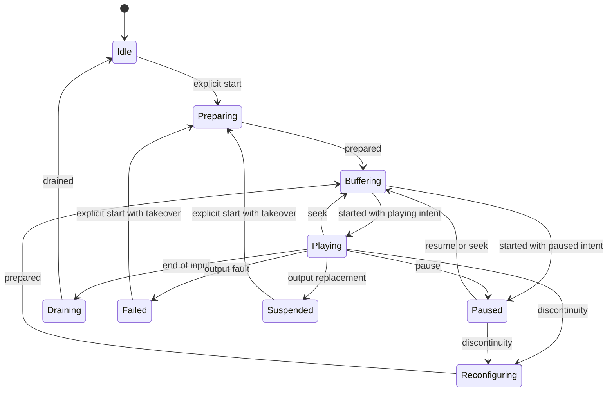
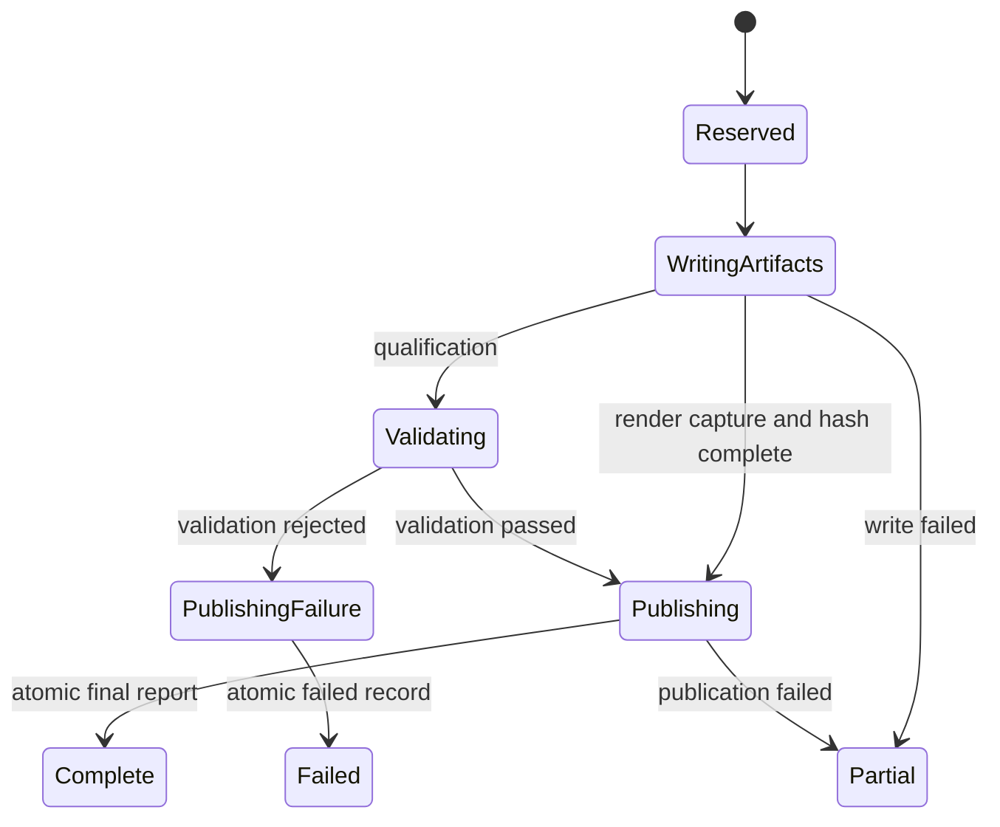

# Implemented state machines

Scope: the Rust core, local owner, media decoder, native outputs, CLIs, harness, and evidence artifacts.
This inventory includes explicit enums and lifecycles previously encoded by flags, optional fields, counters, or file existence.
Third-party internals and unimplemented product features are outside this inventory.

## Decisions

Keep state with the component that owns its effects.
Give listening intent and prepared execution explicit private states.
Treat final reports as commit points.
Keep existing public types, commands, JSON version 1, errors, and artifact names.
Use existing counters, booleans, and checked constructors where they already express the complete invariant.

The original state-machine audit changed six implementation files and their regression tests.
It introduced no state-machine framework or persistent store.
The later T05 spike adds a native adapter with its own explicit lifecycle.

## Inventory

| State boundary | Authority and legal progression | Decision |
|---|---|---|
| Transport | [`Session`](../crates/earph-core/src/session.rs) owns nine `TransportState` variants and guarded commands/events. | Keep the explicit enum. Reject source events in `Idle`, `Suspended`, and `Failed`. |
| Listening intent | `Session` owns `PlaybackIntent::Playing` or `Paused`, independently of buffering and reconfiguration. | Replace the unrestricted pending destination. Pause persists until resume or explicit start. |
| Source ownership and generations | `Session` owns source/session IDs and [`Epochs`](../crates/earph-core/src/ids.rs). Start/takeover advances session; seek/reconfiguration advances stream. | Keep checked counters and exact target checks. Output may install only newer epochs. |
| Asynchronous operations | `SessionSnapshot.operation` identifies pending transport work. Graph jobs and activation retain separate request correlation. | Keep graph acknowledgements from settling transport receipts. Acceptance and application remain distinct. |
| Closing local source | `Session` retains a private pending-stop flag until source termination or replacement. | Reject preparation and repositioning while the worker closes the source. Receipt rotation cannot erase this state. |
| Request retention | `Session::submit` shares 1024 immutable command/receipt records. Same ID/content returns its receipt; changed content rejects. | Keep live graph references and one terminal graph record across history rotation. Preserve the full ordinary window. |
| Graph candidates | [`Session` graph control](../crates/earph-core/src/session_graph.rs) permits one validating, preparing, ready, or activating candidate. | Bind tokens to captured facts and monotonic expiry. Consume once. Keep active execution separate from preparation. |
| Graph activation | Session accepts muted rebuffering in a newer stream epoch. One typed worker acknowledgement carries installed playback facts. | Commit observation and intent together. Gate exact request, epochs, hash, and device generation. Advance `graph_epoch` once. Never unmute on acknowledgement. |
| Graph recovery | Failed activation sets an explicit recovery gate and invalidates its generation. Restart restores intent without runtime claims. | Stop and retire the candidate. Require successful explicit graph activation before unmute. |
| Graph resources | [`GraphService`](../crates/earph-engine/src/graph.rs) owns one preparation slot, two pipeline owners, and two retirement slots. | Admit aggregate storage before allocation. Retire through the executor on every ownership path. |
| Graph kernels | [`PreparedGraph`](../crates/earph-dsp/src/runtime.rs) owns prepared, running, draining, finished, failed, or cancelled execution. | Reset only into newer epochs. Preserve state across compatible joins. Drain each declared tail once. |
| Filter settlement | The compiler selects authored FIR support or bounded IIR truncation and carries per-node future envelopes. | Flush global zeros. Mask FIR-only output after authored support. Verify the final discarded-output bound before preparing a token. |
| Correction assets | The [private store](../crates/earph-engine/src/assets.rs) validates source bytes, publishes immutable content identity, and freezes coefficients during preparation. | Preserve originals and failed writes. Reject conflicting objects, wrong geometry, and missing assets. Never resolve files during processing or activation. |
| Source and tail periods | The worker owns `Feeding -> GraphTail -> BackendDrain -> Finished` and a source-or-tail pending period. | Retain partially written samples. Never reprocess retries or advance source offsets for tail frames. |
| Completed drain handoff | The worker retains one final observation after releasing playback. | Reconcile only a matching mute generation. Preserve harmless settings; reject ended-source repositioning explicitly. |
| Mute and gain intent | `Session` owns mute, gain caps, output consent, and fixed-output arming. | The worker applies admitted software gain. Hardware gain control remains unsupported. Restore caps without consent or arming. |
| Event subscription | `Session::events_since` projects bounded events against a cursor. Pending activation reserves its final completion slot. | Keep sequence-based recovery. Nonterminal observations cannot exhaust completion capacity. Terminal source states cancel graph work. |
| PCM storage | [`PcmBlock`](../crates/earph-core/src/audio.rs) owns typed storage and a checked valid frame span. Reuse changes the span. | Keep checked constructors and valid-prefix serialization. Never serialize unused capacity. |
| Fixture production | [`FixtureSource`](../crates/earph-harness/src/fixture.rs) owns frame position, sequence, and PRNG state. Remaining frames eventually become EOF. | Keep bounded cursors. A zero read ends consumption; the previous block is not fresh audio. |
| Presentation clock | [`VirtualClock`](../crates/earph-harness/src/virtual_output.rs) moves from an unset rate to one fixed running rate. | Keep `Option` and checked arithmetic. Derive time from total consumed frames. |
| Virtual output | `VirtualOutput` owns format, epochs, capacity, cursor, and terminal failure. Writes advance only accepted frames. | Keep the failure boolean. Newer epochs invalidate old packets without reviving failed output. |
| ALSA output | [`AlsaOutput`](../crates/earph-alsa/src/output.rs) owns `Prepared -> Running -> Draining -> Stopped/Failed`, one handle, epochs, and accepted positions. | Start hardware drain once. Observe native completion without resetting end padding. Reject further writes while draining. Stop and close on fatal errors. |
| ALSA capability evidence | Discovery yields advertised hints; opening yields installed client parameters; approved exercises yield client estimates. | Keep plugin byte measurements separate from hardware proof. Never infer downstream transformations on system routes. |
| Core Audio registration | [`SilentRegistration`](../crates/earph-coreaudio/src/native.rs) owns `Registered -> Closed/Failed`, one IOProc ID, and one callback context. | Never start the registration. Destroy its own ID before releasing context. Keep failed destruction terminal and retain context until process exit. |
| Core Audio precision assessment | [`assess`](../crates/earph-coreaudio/src/contract.rs) compares an explicit UID and request against raw physical and virtual descriptors. | Keep observed settings separate from opening, ownership acquisition, and measurement. A format conflict changes no device state. |
| Core Audio playback | [`CoreAudioOutput`](../crates/earph-coreaudio/src/playback.rs) owns prepared, running, paused, stopped, failed, and closed states. | Prebuffer before explicit start. Keep callback delivery separate from audible position. Retain uncertain native contexts until process exit. |
| Native EOF handoff | The Core Audio adapter tracks the current generation's last payload-bearing buffer. | Require consistent SDK sample and host clocks before natural completion. Empty rings and callback counts do not prove completion. |
| Local playback worker | [`Playback`](../crates/earph-engine/src/worker.rs) owns decoders, prepared gain, pending spans, and one native output. | Apply commands through the session actor. Pause, seek, and stop settle after worker acknowledgement. Faults mute and revoke consent. |
| Live queue reservation | [`PlanView`](../crates/earph-engine/src/plan.rs) observes the active entry and one reserved next entry. | Protect those entries. Recheck reservations after durable staging. Roll back rejected edits before reporting failure. |
| Operational checkpoint | [`runtime`](../crates/earph-engine/src/runtime.rs) owns a bounded pending or settled recovery record. | Sync pending intent, replace the checkpoint, then settle under the reservation guard. Reconcile uncertain outcomes before restoring graph intent. See [storage recovery](operational-storage.md). |
| Native observation | The worker projects typed backend observations into the session snapshot. | Separate source, client, and physical formats. Preserve unknown consumed position and delay as null. |
| Prepared execution | [`PreparedRender`](../crates/earph-harness/src/render.rs) owns `Prepared -> Running -> Completed(Result)`. | Replace the consumed flag. Finalization reads the actual terminal result; callers cannot supply success. |
| Block submission and faults | `PreparedRender` owns the decoded block, accepted offset, write limit, and ordered fault cursor. | Keep bounded cursors. Finish each partial write before reading another block; apply each scheduled fault once. |
| Artifact publication | [`persist_render` and `dependency-lock`](../crates/earph-harness/src/main.rs), fixture generation, and [`atomic_json`](../crates/earph-harness/src/lib.rs) own partial and completed file writes. | Commit final render reports after capture and hash. Preserve partial files. Dependency inventory and notices remain sequential updates requiring inspection on failure. |
| Qualification outcome | [`qualify`, `publish_record`, and `validate`](../crates/earph-harness/src/evidence.rs) own candidate results, validation, and final evidence. | Validate before publication. Rejected validation publishes `fail`, never a passing final record. |
| Build provenance | [`build.rs`](../crates/earph-harness/build.rs) freezes source, lock, compiler, target, and profile at compilation. Runtime checkout observations are separate. | Keep immutable build identity. A changed checkout does not relabel an older executable. |
| Dependency qualification | [`inventory`](../crates/earph-harness/src/inventory.rs) records pinned packages/features/license hashes and unselected candidates. Comparison detects drift. | Keep snapshot/validation. Pinning does not mean an adapter is implemented or qualified. |
| Requirement progress | [`requirements.json`](requirements.json) stores implementation and verification states. [`catalog`](../crates/earph-harness/src/catalog.rs) checks vocabulary and references. | Keep declarative progress. Catalog validation is not evidence that a requirement passed. |

CLI JSON and process exit codes project these outcomes.
They are not another owner of transport, rendering, or qualification state.

## Listening and recovery

This diagram shows the principal transport paths.
Mute remains an independent safety state.

`PlaybackIntent` changes on explicit start, pause, and resume.
Seek and discontinuity preserve it.
Reconfiguration can finish while retaining pause.
Failed and suspended sessions reject source progress and discontinuity events.
Explicit restart creates a fresh session generation and stays muted.

## Artifact commit points

This diagram describes render and qualification publication.

Fixture generation similarly reserves a new directory and writes payloads before its bundle manifest.
Fixture loads still verify each payload's declared format, length, and hash.
`dependency-lock` writes its two requested files sequentially and reports success only after both writes complete.
If it fails, inspect both files and their diffs before rerunning or accepting the update.
The final render report appears only after capture and hash writes succeed.
Qualification validates artifact hashes, source prefixes, outcomes, and scope before publishing success.
Failed validation retains a failed record and diagnostic artifacts.
An interrupted atomic write leaves a sibling `.json.partial` file instead of truncated final JSON.

## Operator and agent recovery

| Observation | Next action |
|---|---|
| `STALE_REVISION` | Read a fresh snapshot. Reconcile the change, then submit a new request ID and revision. |
| `STALE_SESSION` | Discard old work. Never rewind output epochs to admit old data. |
| Accepted operation, uncertain result | Replay the identical retained request to inspect its receipt. Inspect the current snapshot too. |
| Cancelled operation | Use the receipt's committed revision and epochs. A replacement operation may already own the session. |
| Output failed or suspended | Keep muted. Request explicit restart/recovery; source events cannot restart playback. |
| Event gap | Replace local assumptions with the supplied snapshot, then continue from its event sequence. |
| Render write failure | Preserve the output directory for diagnosis. A missing final report means publication did not complete. |
| Qualification error or uncertain process exit | Inspect the record and run `evidence-check` before treating it as passed. |
| Existing output directory | Inspect it. Choose a fresh directory for another run; the current tool does not resume in place. |

The session API now also runs behind private Unix IPC in `earph-engine`.
Its CLI forwards the same versioned command envelope and prints JSON receipts.
Use `state.get` to discover the current owner identity and revision.
Mutations target that owner; stale owners reject after restart.
Queue reads use bounded pages with the receipt revision.
`Session::snapshot()` still provides a fresh Rust snapshot for embedded consumers.
Request IDs identify logical reads and mutations; replaying an old state query returns its retained result.

`LocalQueue` owns stable entry identities, selection, ordering, and preparation status.
The session owns queue revisions and receipts.
Persistence commits a staged mutation before the owner publishes its applied receipt.
Recovery validates saved queue bounds and identities, then restores paused and muted.
It discards preparation claims and never opens an output.

`LocalFile` owns packet position, pending PCM, decoder state, and seek generation.
Its explicit reader states separate reading, confirmed EOF, an explicit end seek, and failure.
Natural EOF checks for extra audio beyond the declared frame count.
A failed reader requires a fresh open.
The offline capture owns its bytes and final report; failed writes cannot claim successful hashes.

## Verification and limits

On November 17, 2026, `scripts/check` passed all 55 tests, formatting, lint, catalog, and dependency checks.
An independent read-only review reran those tests and found no remaining issues.
Fresh qualification from clean commit `9e09082` passed 288 exact renders and 18 fault cases, each repeated twice.
The fresh record and archived foundation record both passed `evidence-check`.
The fresh run is retained under `target/state-machines/qualification/` in the task worktree.

Regression tests reproduce paused recovery, terminal-event rejection, cancellation freshness, and backwards output epochs.
Unit tests reject successful finalization before processing and preserve actual outcomes after rejected reprocessing.
Filesystem tests force hash-write failure and rejected evidence validation against real temporary directories.
The existing CLI tests still exercise real producers, consumers, partial captures, and evidence reads.
The allocator test still checks prepared execution without allocations or frees.

The public snapshot does not expose listening intent separately during buffering.
These fixes preserve its existing schema; a future GUI/control contract can add explicit intent through its versioning rules.
The [T05 spike](alsa-spike.md) established Linux plugin measurements and silent host opening.
The [local playback review](local-playback-review.md) records later owner, decoding, and output integration checks.
Core Audio adapter lifecycle, SDK handoff, and scoped owner-and-CLI playback passed hardware acceptance.
The final Linux owner-and-CLI hardware run also passed after the explicit drain correction.
Those observations do not establish DAC preservation, acoustic safety, or full release qualification.
Crash-restored queues now recover paused and muted without opening an output.
Prepared PCM graph review fixes pass 338 Linux tests, with two hardware-gated tests ignored.
The canonical formatting, strict lint, catalog, and dependency checks pass.
Ten real owner/CLI scenarios include graph joins, tails, rebuffering, paused replacement, and restart.
See [prepared graph contracts and limits](dsp-graphs.md).
The same runtime-source digest passes 315 Mac tests, with two hardware-gated tests ignored.
One attenuated graph signal passes on each previously approved Linux and Mac route.
Settings and generated sources remain unchanged.
The [review receipts](evidence/dsp/review-verification-20261118.json) preserve these qualification limits.
The [earlier graph receipts](evidence/dsp/verification-20261118.json) remain bound to their original source snapshot.
Profiles, network roles, FFI clients, and GUIs remain unimplemented or unqualified.
This task does not qualify power-loss durability beyond completed writes and atomic JSON publication.
Their proposed lifecycles remain in [the product specification](SPEC.md).
