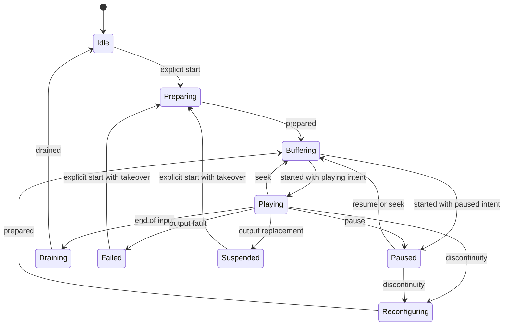
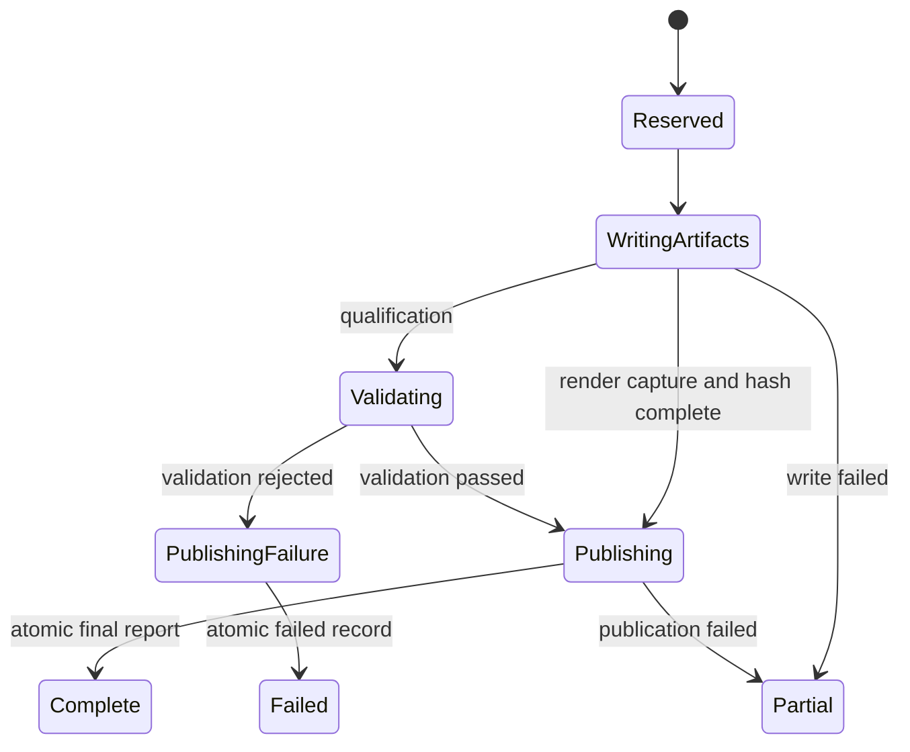

# Implemented state machines

Scope: the Rust core, local owner, media decoder, native outputs, CLIs, harness, and evidence artifacts.
This inventory includes explicit enums and lifecycles previously encoded by flags, optional fields, counters, or file existence.
Third-party internals and unimplemented product features are outside this inventory.

## Decisions

Keep state with the component that owns its effects.
Give listening intent and prepared execution explicit private states.
Treat final reports as commit points.
Keep existing public types, commands, JSON version 1, errors, and artifact names.
Use existing counters, booleans, and checked constructors where they already express the complete invariant.

The original state-machine audit changed six implementation files and their regression tests.
It introduced no state-machine framework or persistent store.
The later T05 spike adds a native adapter with its own explicit lifecycle.

## Inventory

| State boundary | Authority and legal progression | Decision |
|---|---|---|
| Transport | [`Session`](../crates/earph-core/src/session.rs) owns nine `TransportState` variants and guarded commands/events. | Keep the explicit enum. Reject source events in `Idle`, `Suspended`, and `Failed`. |
| Listening intent | `Session` owns `PlaybackIntent::Playing` or `Paused`, independently of buffering and reconfiguration. | Replace the unrestricted pending destination. Pause persists until resume or explicit start. |
| Source ownership and generations | `Session` owns source/session IDs and [`Epochs`](../crates/earph-core/src/ids.rs). Start/takeover advances session; seek/reconfiguration advances stream. | Keep checked counters and exact target checks. Output may install only newer epochs. |
| Asynchronous operations | `SessionSnapshot.operation` identifies pending transport work. Graph jobs and activation retain separate request correlation. | Keep graph acknowledgements from settling transport receipts. Acceptance and application remain distinct. |
| Closing local source | `Session` retains a private pending-stop flag until source termination or replacement. | Reject preparation and repositioning while the worker closes the source. Receipt rotation cannot erase this state. |
| Request retention | `Session::submit` shares 1024 immutable command/receipt records. Same ID/content returns its receipt; changed content rejects. | Keep live graph references and one terminal graph record across history rotation. Preserve the full ordinary window. |
| URI metadata staging | One owner stores one immutable unadmitted descriptor and a checked generation. | Expose bounded identity/count summaries; preserve playback and authorization. Clear explicitly and drop staging on restart. |
| Diagnostic read | One owner cut binds a strict signal-path or metrics report to exact local identities. | Keep the binding private; replay the original report and use a fresh request for current facts. |
| Diagnostic facts | Requested intent, active compilation, retained playback observations and unknown segments have separate owners. | Preserve null origins and unavailable metrics; configured intent and software statistics grant no physical evidence. |
| Diagnostic preview | Session retains one immutable capture with a digest, expiry and optional active export pin. | Expire live authority after 30 seconds. Keep exact historical replay without reviving authority. Refuse replacement while the worker holds the pin. |
| Diagnostic artifact job | [Session artifact control](../crates/earph-core/src/session_diagnostic_artifacts.rs) owns admission, scoped cancellation and matching worker completion. | Keep cancellation requested distinct from retirement. Reserve its receipt capacity and retain the original admission cut. |
| Diagnostic filesystem effects | The [artifact publisher](../crates/earph-engine/src/diagnostic_artifacts.rs) owns staging, installation, sync and bounded readback. | Keep effects separate from receipt status. Preserve stages and report uncertainty; never overwrite, delete or repair a destination automatically. |
| Graph candidates | [`Session` graph control](../crates/earph-core/src/session_graph.rs) permits one validating, preparing, ready, or activating candidate. | Bind tokens to captured facts and monotonic expiry. Consume once. Keep active execution separate from preparation. |
| Graph activation | Session accepts muted rebuffering in a newer stream epoch. One typed worker acknowledgement carries installed playback facts. | Commit observation and intent together. Gate exact request, epochs, hash, and device generation. Advance `graph_epoch` once. Never unmute on acknowledgement. |
| Graph recovery | Failed activation sets an explicit recovery gate and invalidates its generation. Restart restores intent without runtime claims. | Stop and retire the candidate. Require successful explicit graph activation before unmute. |
| Graph resources | [`GraphService`](../crates/earph-engine/src/graph.rs) owns one preparation slot, two pipeline owners, and two retirement slots. | Admit aggregate storage before allocation. Retire through the executor on every ownership path. |
| Saved profile catalog | [`Session` profile control](../crates/earph-core/src/session_profiles.rs) owns immutable named intent and expected revisions. | Publish references only after object durability and the existing checkpoint transaction. Restore paused and muted without runtime authorization. |
| Profile save worker | The shared [artifact worker](../crates/earph-engine/src/artifact_jobs.rs) owns profile saving, retiring and matching completion. | Cancellation can settle a profile receipt before resources retire. Keep the shared reservation until matching completion. Keep Stop, mute and shutdown available. |
| Profile selection | The [pure resolver](../crates/earph-core/src/profiles.rs) reports manual selection, exact match, ambiguity, or no verified match. | An unchanged DAC never identifies passive headphones. Owner associations remain unavailable until native identity evidence is wired. |
| Graph kernels | [`PreparedGraph`](../crates/earph-dsp/src/runtime.rs) owns prepared, running, draining, finished, failed, or cancelled execution. | Reset only into newer epochs. Preserve state across compatible joins. Drain each declared tail once. |
| Streaming graph execution | [`PreparedStreamRender`](../crates/earph-engine/src/stream_render.rs) owns source acceptance, generated output, retained replay, and native submission. | Preserve history across holds and compatible joins. Reset all frontiers on true seek. Drain only after actual final EOF and submitted DSP tails. |
| Streaming replacement | The worker replaces execution at its actual accepted source frontier and publishes discarded held output. | Keep source and output epochs distinct. Preserve irrevocable native acknowledgments after cancellation. Leave audible source position unknown. |
| Filter settlement | The compiler selects authored FIR support or bounded IIR truncation and carries per-node future envelopes. | Flush global zeros. Mask FIR-only output after authored support. Verify the final discarded-output bound before preparing a token. |
| Correction assets | The [private store](../crates/earph-engine/src/assets.rs) validates source bytes, publishes immutable content identity, and freezes coefficients during preparation. | Preserve originals and failed writes. Reject conflicting objects, wrong geometry, and missing assets. Never resolve files during processing or activation. |
| Source and tail periods | The worker owns `Feeding -> GraphTail -> BackendDrain -> Finished` and a source-or-tail pending period. | Retain partially written samples. Never reprocess retries or advance source offsets for tail frames. |
| Completed drain handoff | The worker retains one immutable completion token and final observation after releasing playback. | Reissue proof across matching mute generations and earlier-entry snapshots. Release only on exact acknowledgement or explicit stream replacement. |
| Mute and gain intent | `Session` owns mute, gain caps, output consent, and fixed-output arming. | The worker applies admitted software gain. Hardware gain control remains unsupported. Restore caps without consent or arming. |
| Event subscription | `Session::events_since` projects bounded events against a cursor. Pending activation reserves its final completion slot. | Keep sequence-based recovery. Nonterminal observations cannot exhaust completion capacity. Terminal source states cancel graph work. |
| PCM storage | [`PcmBlock`](../crates/earph-core/src/audio.rs) owns typed storage and a checked valid frame span. Reuse changes the span. | Keep checked constructors and valid-prefix serialization. Never serialize unused capacity. |
| Fixture production | [`FixtureSource`](../crates/earph-harness/src/fixture.rs) owns frame position, sequence, and PRNG state. Remaining frames eventually become EOF. | Keep bounded cursors. A zero read ends consumption; the previous block is not fresh audio. |
| Presentation clock | [`VirtualClock`](../crates/earph-harness/src/virtual_output.rs) moves from an unset rate to one fixed running rate. | Keep `Option` and checked arithmetic. Derive time from total consumed frames. |
| Virtual output | `VirtualOutput` owns format, epochs, capacity, cursor, and terminal failure. Writes advance only accepted frames. | Keep the failure boolean. Newer epochs invalidate old packets without reviving failed output. |
| ALSA output | [`AlsaOutput`](../crates/earph-alsa/src/output.rs) owns `Prepared -> Running -> Draining -> Stopped/Failed`, one handle, epochs, and accepted positions. | Start hardware drain once. Observe native completion without resetting end padding. Reject further writes while draining. Stop and close on fatal errors. |
| ALSA capability evidence | Discovery yields advertised hints; opening yields installed client parameters; approved exercises yield client estimates. | Keep plugin byte measurements separate from hardware proof. Never infer downstream transformations on system routes. |
| Core Audio registration | [`SilentRegistration`](../crates/earph-coreaudio/src/native.rs) owns `Registered -> Closed/Failed`, one IOProc ID, and one callback context. | Never start the registration. Destroy its own ID before releasing context. Keep failed destruction terminal and retain context until process exit. |
| Core Audio precision assessment | [`assess`](../crates/earph-coreaudio/src/contract.rs) compares an explicit UID and request against raw physical and virtual descriptors. | Keep observed settings separate from opening, ownership acquisition, and measurement. A format conflict changes no device state. |
| Core Audio playback | [`CoreAudioOutput`](../crates/earph-coreaudio/src/playback.rs) owns prepared, running, paused, stopped, failed, and closed states. | Prebuffer before explicit start. Keep callback delivery separate from audible position. Retain uncertain native contexts until process exit. |
| Core Audio first fault | [`FaultSignal`](../crates/earph-coreaudio/src/playback/fault.rs) moves once from empty to one packed reason and optional frame counts. | Publish one complete record without callback allocation or logging. Preserve the first cause through later notifications and cleanup. Unknown codes remain terminal. |
| Native EOF handoff | The Core Audio adapter tracks the current generation's last payload-bearing buffer. | Require consistent SDK sample and host clocks before natural completion. Empty rings and callback counts do not prove completion. |
| Local playback worker | [`Playback`](../crates/earph-engine/src/worker.rs) owns decoders, prepared gain, pending spans, and one native output. | Apply commands through the session actor. Pause, seek, and stop settle after worker acknowledgement. Faults mute and revoke consent. |
| Live queue reservation | [`PlanView`](../crates/earph-engine/src/plan.rs) observes the active entry and one reserved next entry. | Protect those entries. Recheck reservations after durable staging. Roll back rejected edits before reporting failure. |
| Operational checkpoint | [`runtime`](../crates/earph-engine/src/runtime.rs) owns a bounded pending or settled recovery record. | Sync pending intent, replace the checkpoint, then settle under the reservation guard. Reconcile uncertain outcomes before restoring graph intent. See [storage recovery](operational-storage.md). |
| Native observation | The worker projects typed backend observations into the session snapshot. | Separate source, client, and physical formats. Preserve unknown consumed position and delay as null. |
| Prepared execution | [`PreparedRender`](../crates/earph-harness/src/render.rs) owns `Prepared -> Running -> Completed(Result)`. | Replace the consumed flag. Finalization reads the actual terminal result; callers cannot supply success. |
| Block submission and faults | `PreparedRender` owns the decoded block, accepted offset, write limit, and ordered fault cursor. | Keep bounded cursors. Finish each partial write before reading another block; apply each scheduled fault once. |
| Artifact publication | [`persist_render` and `dependency-lock`](../crates/earph-harness/src/main.rs), fixture generation, and [`atomic_json`](../crates/earph-harness/src/lib.rs) own partial and completed file writes. | Commit final render reports after capture and hash. Preserve partial files. Dependency inventory and notices remain sequential updates requiring inspection on failure. |
| Qualification outcome | [`qualify`, `publish_record`, and `validate`](../crates/earph-harness/src/evidence.rs) own candidate results, validation, and final evidence. | Validate before publication. Rejected validation publishes `fail`, never a passing final record. |
| Build provenance | The [shared build helper](../build_support/provenance.rs) freezes separate Engine and harness input sets at compilation. Engine attaches its record before publishing its endpoint. | Keep compiled package facts separate from runtime executable identity, checkout observations and release evidence. A changed checkout does not relabel an older executable. |
| Dependency qualification | [`inventory`](../crates/earph-harness/src/inventory.rs) records pinned packages/features/license hashes and unselected candidates. Comparison detects drift. | Keep snapshot/validation. Pinning does not mean an adapter is implemented or qualified. |
| Requirement progress | [`requirements.json`](requirements.json) stores implementation and verification states. [`catalog`](../crates/earph-harness/src/catalog.rs) checks vocabulary and references. | Keep declarative progress. Catalog validation is not evidence that a requirement passed. |

CLI JSON and process exit codes project these outcomes.
They are not another owner of transport, rendering, or qualification state.

## Listening and recovery

This diagram shows the principal transport paths.
Mute remains an independent safety state.

`PlaybackIntent` changes on explicit start, pause, and resume.
Seek and discontinuity preserve it.
Reconfiguration can finish while retaining pause.
Failed and suspended sessions reject source progress and discontinuity events.
Explicit restart creates a fresh session generation and stays muted.

## Artifact commit points

This diagram describes render and qualification publication.

Fixture generation similarly reserves a new directory and writes payloads before its bundle manifest.
Fixture loads still verify each payload's declared format, length, and hash.
`dependency-lock` writes its two requested files sequentially and reports success only after both writes complete.
If it fails, inspect both files and their diffs before rerunning or accepting the update.
The final render report appears only after capture and hash writes succeed.
Qualification validates artifact hashes, source prefixes, outcomes, and scope before publishing success.
Failed validation retains a failed record and diagnostic artifacts.
An interrupted atomic write leaves a sibling `.json.partial` file instead of truncated final JSON.

## Operator and agent recovery

| Observation | Next action |
|---|---|
| `STALE_REVISION` | Read a fresh snapshot. Reconcile the change, then submit a new request ID and revision. |
| `STALE_SESSION` | Discard old work. Never rewind output epochs to admit old data. |
| Accepted operation, uncertain result | Replay the identical retained request to inspect its receipt. Inspect the current snapshot too. |
| Cancelled operation | Use the receipt's committed revision and epochs. A replacement operation may already own the session. |
| Output failed or suspended | Keep muted. Request explicit restart/recovery; source events cannot restart playback. |
| Event gap | Replace local assumptions with the supplied snapshot, then continue from its event sequence. |
| Render write failure | Preserve the output directory for diagnosis. A missing final report means publication did not complete. |
| Qualification error or uncertain process exit | Inspect the record and run `evidence-check` before treating it as passed. |
| Existing output directory | Inspect it. Choose a fresh directory for another run; the current tool does not resume in place. |

The session API now also runs behind private Unix IPC in `earph-engine`.
Its CLI forwards the same versioned command envelope and prints JSON receipts.
Use `state.get` to discover the current owner identity and revision.
Mutations target that owner; stale owners reject after restart.
Queue reads use bounded pages with the receipt revision.
`Session::snapshot()` still provides a fresh Rust snapshot for embedded consumers.
Request IDs identify logical reads and mutations; replaying an old state query returns its retained result.

`LocalQueue` owns stable entry identities, selection, ordering, and preparation status.
The session owns queue revisions and receipts.
Persistence commits a staged mutation before the owner publishes its applied receipt.
Recovery validates saved queue bounds and identities, then restores paused and muted.
It discards preparation claims and never opens an output.

`LocalFile` owns packet position, pending PCM, decoder state, and seek generation.
Its explicit reader states separate reading, confirmed EOF, an explicit end seek, and failure.
Natural EOF checks for extra audio beyond the declared frame count.
A failed reader requires a fresh open.
The offline capture owns its bytes and final report; failed writes cannot claim successful hashes.

## Verification and limits

On November 17, 2026, `scripts/check` passed all 55 tests, formatting, lint, catalog, and dependency checks.
An independent read-only review reran those tests and found no remaining issues.
Fresh qualification from clean commit `9e09082` passed 288 exact renders and 18 fault cases, each repeated twice.
The fresh record and archived foundation record both passed `evidence-check`.
The fresh run is retained under `target/state-machines/qualification/` in the task worktree.

Regression tests reproduce paused recovery, terminal-event rejection, cancellation freshness, and backwards output epochs.
Unit tests reject successful finalization before processing and preserve actual outcomes after rejected reprocessing.
Filesystem tests force hash-write failure and rejected evidence validation against real temporary directories.
The existing CLI tests still exercise real producers, consumers, partial captures, and evidence reads.
The allocator test still checks prepared execution without allocations or frees.

The public snapshot does not expose listening intent separately during buffering.
These fixes preserve its existing schema; a future GUI/control contract can add explicit intent through its versioning rules.
The [T05 spike](alsa-spike.md) established Linux plugin measurements and silent host opening.
The [local playback review](local-playback-review.md) records later owner, decoding, and output integration checks.
Core Audio adapter lifecycle, SDK handoff, and scoped owner-and-CLI playback passed hardware acceptance.
The final Linux owner-and-CLI hardware run also passed after the explicit drain correction.
Those observations do not establish DAC preservation, acoustic safety, or full release qualification.
Crash-restored queues now recover paused and muted without opening an output.
Prepared PCM graph review fixes pass 361 Linux tests, with two hardware-gated tests ignored.
The canonical formatting, strict lint, catalog, and dependency checks pass.
Real owner/CLI scenarios include graph joins, tails, rebuffering, paused replacement, restart, and retained semantic rejections.
See [prepared graph contracts and limits](dsp-graphs.md).
The same runtime-source digest passes 331 Mac tests, with two hardware-gated tests ignored.
One attenuated graph signal passes on each previously approved Linux and Mac route.
Settings and generated sources remain unchanged.
The [final review receipts](evidence/dsp/final-review-verification-20261118.json) preserve these qualification limits.
The overlapping eleven-test SDK recheck also passes.
Earlier [review receipts](evidence/dsp/review-verification-20261118.json) retain their original source binding.
The [earlier graph receipts](evidence/dsp/verification-20261118.json) remain bound to their original source snapshot.
Profile imports, profile application, network roles, FFI clients, and GUIs remain unimplemented or unqualified.
This task does not qualify power-loss durability beyond completed writes and atomic JSON publication.
Their proposed lifecycles remain in [the product specification](SPEC.md).

## Streaming DSP evidence

The live SRC worker preserves separate source, generated-output, and native-submission frontiers.
Real owner tests cover holds, compatible joins, true seeks, replacement, cancellation, and retained native prefixes.
The selected Linux release hardware run submits all 26313 generated frames from 24000 source frames.
The first Mac hardware run fails after 2993 producer-ring writes; its native cause remains unknown.
Later first-fault diagnostics pass software and silent SDK checks, without reclassifying that historical failure.
Prepared software CPU checks pass on both reference hosts; they exclude native scheduling and driver work.
See the [DSP checkpoint](superpowers/plans/2026-11-18-dsp-nodes.md) for source bindings and public receipts.

## Saved profile evidence

Named profile saves, updates, queries, manual resolution, and restart use the existing owner command contract.
The reviewed save unit passes 633 Linux tests and a 30-test Mac owner/filesystem gate.
The Mac gate records its dirty precommit source explicitly.
Both immutable profile objects and FIR retries synchronize the verified regular file before its directory.
These tests prove successful application synchronization, without simulating power loss or an actual disk-sync failure.
See [saved profile commands](listening-profile-save.md) and [the profile checkpoint](superpowers/plans/2026-11-18-listening-profiles.md).
The desktop checkpoints below track correction imports, device associations, atomic application, and package work.

## Native desktop control lifecycles

The desktop keeps one client, presentation model, foreground task, and captured waiting action.
Local drafts grant no output authority.

| Lifecycle | Owner and progression | Recovery rule |
| --- | --- | --- |
| Captured action | Controller: draft, waiting, fresh preflight, sent, Accepted, terminal or uncertain. | Refuse stale context; preserve exact bytes and request identity. |
| Ordinary delivery | One bounded dispatcher lane carries foreground requests, observations and exact reconciliation. | Preserve unsent captures in the existing waiting slot. Defer reconciliation without changing the original request. |
| Emergency action | Two bounded safety admissions let Mute and Stop preempt unsent ordinary intent. | Preserve sent receipts and actual owner settlement. Never depend on the worker waking between admissions. |
| Muted transport | Accepted Start, Resume, or playing-intent Seek may outlive foreground occupancy. | Keep polling the pinned exact request without claiming playback. |
| Observation | Adopt a complete fenced snapshot before retiring its successful internal receipt. | Retain latest observation and provenance; keep failures and uncertainty visible. |
| Discovery | Bind each native query to its observed owner. | Invalidate inventory and block old-owner reconciliation after replacement. |
| Receipt disclosure | Request identity owns persistent headers and exact-body scopes. | Disable reconciliation during delivery instead of removing the control. |
| Profile draft | Catalog selection, immutable saved facts, and the loaded local draft remain separate. | Get preserves edits; explicit Load replaces the draft. |
| Graph draft | One canonical intent owns structured edits and accepted raw text. | Pending or invalid raw edits block saving and activation. |
| Prepared graph | Controller binds token kind, hash, owner, source, expiry, and draft generation. | Reconciled preparation remains historical; expiry or explicit Mute precedes another Prepare. |
| Profile refresh | Capture the owner and zone, then fence the actual read with fresh Before and After observations. | Accept newer revisions from that owner; reject owner replacement or changes during the read. |
| Correction preview | One joinable local worker binds input, metadata, draft generation and owner context. | Cancel late adoption after edits, safety actions, owner replacement or close. |
| Correction review | Actual saved documents and owner-verified FIR assets require explicit local review. | Advisory path previews grant no import identity; reconstruction creates new source bytes. |
| FIR insertion | The canonical graph accepts one explicitly reviewed compatible asset. | Preserve existing nodes and processing intent; never apply or add hidden gain. |
| Package candidate | An owner preview or inspection binds exact saved references, object hashes, sources and manifest. | Reconcile the captured request before adopting a new candidate; retain historical results without publication authority. |
| Package review | One joinable local worker reads original bytes; each object needs an explicit review mark. | Edits, destination changes, cancellation and owner changes invalidate local acknowledgments. |
| Package publication | Explicit exact-candidate, privacy and measurement choices bind one import or export. | Preserve uncertain outcomes and filesystem facts; inspect the captured destination instead of retrying a write. |
| Diagnostic observations | Immutable owner replies retain their request, capture cut and exact redacted payload. | Keep sparse history and unavailable metrics explicit. Never replace newer product state with historical event pages. |
| Diagnostic review | An explicit capture binds preview identity, owner, digest and destination acknowledgment. | Owner changes, new captures and destination edits clear review. Historical reconciliation does not restore export authority. |
| Diagnostic pending work | Accepted artifacts release foreground delivery while retaining fair exact-request polling. | Keep inspect and cancellation available. Read filesystem effects from retained receipts without another job queue or automatic publication retry. |

Fixed arming has no State readback.
Discovery properties do not prove an opened output or physical presentation.
See the [desktop checkpoint](superpowers/plans/2026-11-18-desktop-connect-queue.md) for exact evidence and remaining limits.

## Admitted network reader

The local owner supplies one immutable source binding and exact origin grants.
Permit construction compares that binding with current owner state.
This reader does not mint authority or update the owner's grant registry.

`Idle → Startup → Headers → Body` starts one owned transport task.
A redirect returns to `Headers` only after fresh origin and expiry admission.
`Body → Backpressure → Body` waits for consumer capacity without a server-stall deadline.
`Body → Complete` requires verified HTTP body completion.
Any active phase can finish as `Cancelled` or `Failed`.
Terminal state is recorded before the reader wakes.
Failure and cancellation discard queued body data.
Only `Complete` drains queued data and returns EOF.
Every observation retains the immutable owner, session, media, and generation binding.

Cancellation wakes the reader and runtime supervisor.
The supervisor aborts and awaits its retained task.
Retirement then joins the owned OS thread.
A one-second cleanup timeout retains thread ownership and blocks replacement.
Successful retirement returns the worker to `Idle`.
Worker drop cancels and joins as a final ownership safeguard.
The caller must use explicit retirement when it needs a bounded cleanup result.

See [network media](network-media.md) for transport budgets, tests, and qualification limits.

## Admitted FLAC worker

`NetworkFlacWorker` accepts an existing permit and an independently captured current source binding.
The caller serializes readiness, frame, and completion adoption with live owner authority.
An old snapshot or a binding reconstructed from the permit does not satisfy that precondition.

`Idle → Active` starts one owned transport thread and one decoder thread.
Every readiness, frame, and completion adoption compares the immutable binding with current authority.
One pending PCM frame blocks further packet decoding until the caller consumes it.
Inspection still observes live transport failure while that slot stays full.
Failure discards the frame and wakes the decoder.

Frame acceptance takes decode state before the transport publication lock.
The bounded move under both locks defines acceptance.
Readiness and success use the same terminal fence.
A failure that acquires the transport lock first prevents later acceptance.
A later failure cannot retract a frame already accepted.
Any later native output stage requires its own authority fence.

Media EOF, matching HTTP completion, and an empty frame slot establish `Complete`.
Unknown duration stays unknown.
Decode failure and transport failure remain distinct and survive later cancellation.
Owner cancellation revokes handoff even after HTTP completion.
Dropping a rejected media reader does not establish owner cancellation.

`Active → Retiring` revokes handoff before waking decoder waits and cancelling transport.
A changed current binding also enters `Retiring` and rejects the old result.
Decoder retirement permits one second; subsequent transport retirement permits another second.
Either timeout retains the job and its unjoined handles.
Replacement stays blocked until both threads retire.
Successful retirement returns to `Idle`.
A failed decoder thread start retains the started transport in `Retiring`.
Final destruction joins unfinished work and may block.

This worker supplies no owner grant registry, network session reservation, queue entry, or native output path.

## Owner HTTP-FLAC playback

`sources.grants.replace` installs one volatile, generation-fenced grant document after real host-policy validation.
`sources.stage_uri` retains an unadmitted descriptor without transport.
`sources.start_http_flac` binds the exact descriptor, source generation, grant generation, owner, and session.
The host reserves playback capacity and commits before dispatching transport.
Outgoing native/source ownership retires before replacement I/O begins.

`Preparing → Ready` adopts received format and optional duration while remaining muted.
An explicitly prepared and committed floating graph installs the shared streaming renderer.
Unmute then permits native submission and settles the pending start after an actual Started event.
`Playing → Paused → Playing` uses bounded streaming hold and replay without seeking or reopening HTTP.
Source epochs remain immutable across output and graph transitions.
Graph replacement reports nonzero held-output discard through a source-bound `replacement_boundary`.
The accepted source frontier and discarded previous-client output frames retain their separate domains.
The record retains previous/current transition epochs and can survive later same-source output transitions.
Temporary missing input leaves the source active; verified media EOF begins graph-tail and native drain.
Successful completion preserves the optional duration and exact measured counters.

Revoke, grant replacement, expiry, Stop, failure, and shutdown remove execution authority first.
One closing context retains the old binding and exact cleanup fences after live authority advances.
The playback worker stops native submission and retires the decoder and transport.
A cleanup timeout retains ownership and keeps ordinary replacement admission busy.
Only the matching retirement acknowledgement releases that closing context.
This acknowledgement cannot restore source authority or publish PCM.
The local queue never receives fabricated entries or network readiness.

## Renderer execution and events

`Session` owns controller grants, callback grants, graph continuations, subscriptions, and delivery identity.
The [renderer contract](upnp-core-contract.md) defines the adapter and Engine boundaries.
Accepted Play captures authored graph intent, output selection, device epoch, source binding, and controller generation.
Measured readiness permits fresh preparation, followed by its exact commit token and worker acknowledgement.
Each adoption rechecks live authority.
Exact accepted replay returns the retained receipt without repeating effects.
Stop, revocation, expiry, or replacement invalidates the continuation before cleanup.

Subscription admission reserves the initial snapshot, delivery identity, and adapter lease before publishing a SID.
Successful response write completion and TCP shutdown permit the initial event.
Later changes replace one latest snapshot while preserving initial and in-flight ownership.
Each SID permits one in-flight event; Core permits four globally.
Unsubscribe can retain one initial attempt under independent live callback authority.
Revocation removes authority before transport cancellation.
A failed join retains closing ownership and its reservation until exact completion.

SOAP getters and event encoding share one projection.
The writer checks both XML layers before staging commits.
The [Core receipt](evidence/network/upnp-core-linux-20261120.json) covers these software contracts.
The [Network adapter](upnp-network-execution.md) owns concrete event leases and bounded, joined NOTIFY senders.
The [Engine bridge](upnp-owner-execution.md) serializes requests through the existing owner and shared playback worker.
A paused Play resumes only when the staged and active media identities match.
A replacement keeps its live graph authority while the outgoing source retires.
Graph execution waits for that source's exact retirement acknowledgement.
Stop, revocation, and expiry still invalidate waiting authority.
Joint controller tests remain a separate qualification gate.
Production renderer startup remains disabled.

## Sendspin session and pairing writes

[`ClientSession`](../crates/earph-sendspin/src/session.rs) owns handshake phases, encrypted messages, admission, and key rotation.
It keeps `Quiet` distinct from active delivery and waits for exact write completion before advancing keys.
The pairing reducer owns authorization, candidate records, durable commit acknowledgement, and recovery after uncertain writes.
An obsolete, unstarted write loses authorization before transport begins.
An earlier completed write retains its acknowledgement across rotation.
The session's first-send clock remains with that reducer.

Bounded queues and generation checks reject stale work without duplicating the reducer's state in adapters.
Cancellation stops new work; acknowledged durable writes still require their actual completion.
See [Sendspin sessions](sendspin-session.md) for the verified library contract and its recovery limits.
Production credentials, player roles, clocks, and playback remain unfinished.
Protocol admission grants no source or output authority.

## Outbound Sendspin transport

The [outbound driver](sendspin-runtime.md) owns one explicit roleless connection and one unsplit WebSocket.
Producer admission reserves aggregate credits before parsing; pending and dequeued work retain those credits until transfer.
Consumer event leases hold their credits until release.
Cancellation ends new work before closing the socket.
A pending write becomes uncertain before a bounded peer Close reply can drain the same socket.
That drain cannot acknowledge the uncertain write or resend it through another connection.
An acknowledged durable commit survives socket closure and remains owned until its exact completion.
A retirement timeout retains the thread handle; a later retirement joins the same owner.
Uncertain storage blocks replacement until explicit caller recovery.
Application startup, OS storage, player roles, clock discipline, and output remain separate work.

## Committed credential restoration

[`CommittedCredentials`](../crates/earph-sendspin/src/credentials.rs) owns permanent identity, permanent pairing PSK, and one `RecordCatalog`.
Restoration checks the byte budget, strict document shape, version, and catalog invariants before returning credentials.
It preserves superseded records and checked use order, including counter exhaustion.
Every field must exist; an absent last-playback server uses explicit `null`.
Invalid input returns a fixed error without generating identity or repairing state.
The encoded wrapper redacts Debug and exposes plaintext only through its explicit secret-byte API.
The [credential contract](sendspin-credentials.md) defines this boundary without selecting an OS store or granting runtime authority.

## Native credential transactions

[`CredentialStore`](../crates/earph-credentials/src/lib.rs) owns one native helper and one stable exclusive marker lock.
An operation records pending intent before issuing a native mutation.
Exact fresh readback permits completion; timeout, cancellation, or lost acknowledgement preserves uncertainty.
The pending operation identity survives reopening the store.
A recovery read observes storage without clearing that identity.
Explicit native-completion acknowledgement requires a later fresh read inside that acknowledgement.
Helper exit alone cannot establish daemon-side completion.
The marker file and its parent directory sync before helper execution.
Directory-sync failure refuses opening and preserves existing pending bytes.
The [native contract](native-credentials.md) requires explicit providers and forbids prompts, repair, and plaintext fallback.
The [Linux receipt](evidence/sendspin/native-credentials-linux-20261121.json) binds actual isolated native storage and directory-failure checks.
Hosted Mac qualification and production service wiring remain separate gates.

## Typed DSD software transport

[`DsdFile`](../crates/earph-media/src/dsd.rs) owns the file, one-bit sample position, sequence, and epochs.
A failed read, failed seek, or cancellation retires its reader.
Successful aligned seeking resets the sequence and adopts the supplied epochs without manufacturing PCM.
The caller supplies the new stream boundary and creates its codec.
[`DopPacker`](../crates/earph-core/src/dop.rs) owns marker phase, pending source bytes, sequence, and terminal state.
Fragments preserve marker alternation; an incomplete final frame fails instead of adding filler.
Failure or cancellation ends the packer.
`DopUnpacker` retains a terminal failure latch after invalid stream data.
Create a new stream codec after a seek or failed stream.
The [DSD software contract](dsd-software.md) keeps these typed blocks outside PCM DSP.
Engine owns PCM/HTTP or DSD through one active worker variant.
DSD source admission publishes `DsdReady` and a mutually exclusive `dsd_playback` projection.
Pause, mute, cancellation, and seek close the typed native owner without PCM silence or drain.
Accepted source bits determine the software restart cursor; decoded bits and carrier frames remain separate.
Each reopen resets native counters, marker phase, and sequence under fresh output epochs.
The immediately preceding close boundary retains its old accepted count and source identity.
Failed retirement owns one immutable record until the host adopts that same record.
Queue backpressure and an occupied host slot keep the worker's record pending.
Only a distinct matching retirement acknowledgement releases the worker's historical slot.
Current-source acknowledgements cannot release that slot, even when their token values match.
Failed diagnostic writes keep the host's bounded record until reporting succeeds or the host exits.
Compatible queue joins preserve one packer and stream across entry identities.
EOF closes and reports source-submission completion rather than native drain.
Public unmute remains blocked until concrete endpoint-specific DSD qualification exists.
Private file/null tests provide software transport evidence only.
Physical DSD qualification and typed Core Audio output remain unfinished.

## Native package candidates

The [package builder](../crates/earph-harness/src/package.rs) owns a newly created output directory and its partial files.
It validates explicit products and canonical metadata before publishing the final inventory.
Failure retains partial output and reports its path.
Use another new directory for a later attempt; inspect retained files before requesting cleanup.
The verifier checks the complete tree without repairing it or launching products.
Package consistency, declared provenance, exact product qualification, and authenticated release remain separate facts.
See [native packaging](native-packaging.md) for limits and the exact packaged Linux GUI receipt.

## Sendspin native service completions

[`CredentialSupervisor`](../crates/earph-engine/src/sendspin_credentials.rs) owns one thread, native store, and connection lease.
One operation slot covers queued work and its undelivered result.
Successful cancellable results remain fenced until their receiver consumes them.
Admission and candidate delivery also require a current policy.
An acknowledged commit retains its original attempt and terminal result through cancellation and retirement.
A lost receiver preserves uncertainty instead of cancelling native work.
Recovery observations clear neither native nor bridge uncertainty.
Bounded retirement retains the thread and stable lock until work settles.
Final destruction joins retained work and can wait on system randomness.
The [service contract](sendspin-native-services.md) keeps provisioning, startup, roles, clocks, and output separate.
The [combined Linux receipt](evidence/sendspin/runtime-timing-native-linux-20261121.json) binds actual native storage and authenticated transport.

## Sendspin clock discipline

[`TimeSync`](../crates/earph-sendspin/src/timing.rs) owns one binding, bounded probe burst, and numeric filter.
Its snapshot distinguishes uninitialized, mapped, stale, numeric-fault, and retired states.
The caller supplies monotonic microseconds and policy deadlines.
Probe tokens distinguish an offered request from an actually emitted request.
Only a matching, timely reply contributes to its current burst.
Mapping results retain the clock binding and mapping revision.
Stale, retired, and invalid numeric states cannot supply a usable mapping.
The [timing contract](sendspin-timing.md) separates numeric mapping from live transport and output authority.
The [combined Linux receipt](evidence/sendspin/runtime-timing-native-linux-20261121.json) binds its integrated pipeline and boundary checks.
