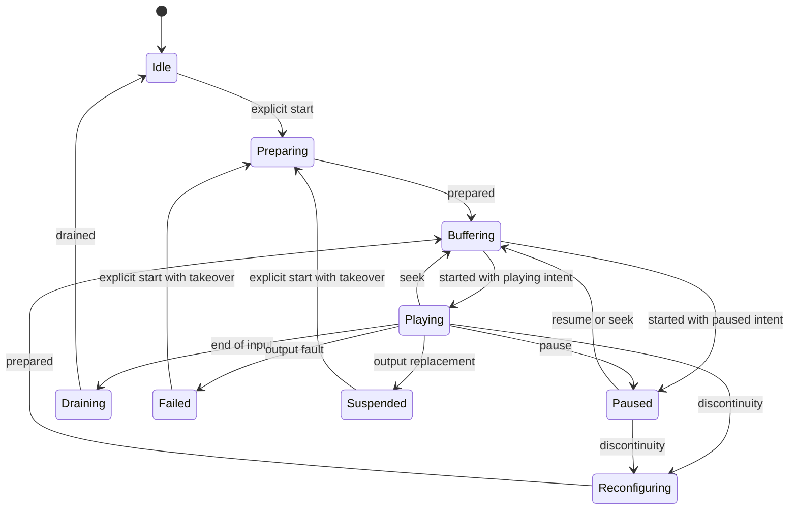
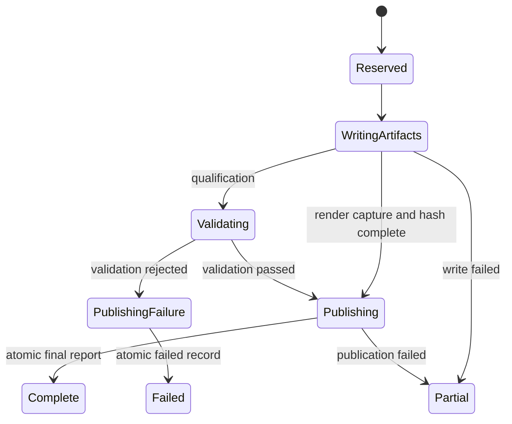

# Implemented state machines

Scope: the Rust core, offline harness, CLI, build metadata, and qualification artifacts.
This inventory includes explicit enums and lifecycles previously encoded by flags, optional fields, counters, or file existence.
Third-party internals and unimplemented product features are outside this inventory.

## Decisions

Keep state with the component that owns its effects.
Give listening intent and prepared execution explicit private states.
Treat final reports as commit points.
Keep existing public types, commands, JSON version 1, errors, and artifact names.
Use existing counters, booleans, and checked constructors where they already express the complete invariant.

The work changes six implementation files and their regression tests.
It introduces no state-machine framework, new dependency, persistent store, or control surface.

## Inventory

| State boundary | Authority and legal progression | Decision |
|---|---|---|
| Transport | [`Session`](../crates/earph-core/src/session.rs) owns nine `TransportState` variants and guarded commands/events. | Keep the explicit enum. Reject source events in `Idle`, `Suspended`, and `Failed`. |
| Listening intent | `Session` owns `PlaybackIntent::Playing` or `Paused`, independently of buffering and reconfiguration. | Replace the unrestricted pending destination. Pause persists until resume or explicit start. |
| Source ownership and generations | `Session` owns source/session IDs and [`Epochs`](../crates/earph-core/src/ids.rs). Start/takeover advances session; seek/reconfiguration advances stream. | Keep checked counters and exact target checks. Output may install only newer epochs. |
| Asynchronous operations | `SessionSnapshot.operation` identifies pending work. [`ReceiptStatus`](../crates/earph-core/src/control.rs) separates acceptance from terminal outcomes. | Cancel superseded work after committing the replacement revision and epochs. |
| Request retention | `Session::submit` retains 1024 command/receipt pairs. Same ID/content returns its receipt; changed content rejects; eviction ends deduplication. | Keep bounded history. Reconcile uncertain outcomes before retrying. |
| Mute and gain intent | `Session` owns mute independently of transport. Startup, handoff, output faults, and reconfiguration mute. | Keep the boolean. Software gain is intent here; physical gain control is unimplemented. |
| Event subscription | `Session::events_since` projects bounded events against a cursor. Old or future cursors receive a gap and snapshot. | Keep sequence-based recovery. Position progress changes event sequence, not mutation revision. |
| PCM storage | [`PcmBlock`](../crates/earph-core/src/audio.rs) owns typed storage and a checked valid frame span. Reuse changes the span. | Keep checked constructors and valid-prefix serialization. Never serialize unused capacity. |
| Fixture production | [`FixtureSource`](../crates/earph-harness/src/fixture.rs) owns frame position, sequence, and PRNG state. Remaining frames eventually become EOF. | Keep bounded cursors. A zero read ends consumption; the previous block is not fresh audio. |
| Presentation clock | [`VirtualClock`](../crates/earph-harness/src/virtual_output.rs) moves from an unset rate to one fixed running rate. | Keep `Option` and checked arithmetic. Derive time from total consumed frames. |
| Virtual output | `VirtualOutput` owns format, epochs, capacity, cursor, and terminal failure. Writes advance only accepted frames. | Keep the failure boolean. Newer epochs invalidate old packets without reviving failed output. |
| Prepared execution | [`PreparedRender`](../crates/earph-harness/src/render.rs) owns `Prepared -> Running -> Completed(Result)`. | Replace the consumed flag. Finalization reads the actual terminal result; callers cannot supply success. |
| Block submission and faults | `PreparedRender` owns the decoded block, accepted offset, write limit, and ordered fault cursor. | Keep bounded cursors. Finish each partial write before reading another block; apply each scheduled fault once. |
| Artifact publication | [`persist_render` and `dependency-lock`](../crates/earph-harness/src/main.rs), fixture generation, and [`atomic_json`](../crates/earph-harness/src/lib.rs) own partial and completed file writes. | Commit final render reports after capture and hash. Preserve partial files. Dependency inventory and notices remain sequential updates requiring inspection on failure. |
| Qualification outcome | [`qualify`, `publish_record`, and `validate`](../crates/earph-harness/src/evidence.rs) own candidate results, validation, and final evidence. | Validate before publication. Rejected validation publishes `fail`, never a passing final record. |
| Build provenance | [`build.rs`](../crates/earph-harness/build.rs) freezes source, lock, compiler, target, and profile at compilation. Runtime checkout observations are separate. | Keep immutable build identity. A changed checkout does not relabel an older executable. |
| Dependency qualification | [`inventory`](../crates/earph-harness/src/inventory.rs) records pinned packages/features/license hashes and unselected candidates. Comparison detects drift. | Keep snapshot/validation. Pinning does not mean an adapter is implemented or qualified. |
| Requirement progress | [`requirements.json`](requirements.json) stores implementation and verification states. [`catalog`](../crates/earph-harness/src/catalog.rs) checks vocabulary and references. | Keep declarative progress. Catalog validation is not evidence that a requirement passed. |

CLI JSON and process exit codes project these outcomes.
They are not another owner of transport, rendering, or qualification state.

## Listening and recovery

This diagram shows the principal transport paths.
Mute remains an independent safety state.

`PlaybackIntent` changes on explicit start, pause, and resume.
Seek and discontinuity preserve it.
Reconfiguration can finish while retaining pause.
Failed and suspended sessions reject source progress and discontinuity events.
Explicit restart creates a fresh session generation and stays muted.

## Artifact commit points

This diagram describes render and qualification publication.

Fixture generation similarly reserves a new directory and writes payloads before its bundle manifest.
Fixture loads still verify each payload's declared format, length, and hash.
`dependency-lock` writes its two requested files sequentially and reports success only after both writes complete.
If it fails, inspect both files and their diffs before rerunning or accepting the update.
The final render report appears only after capture and hash writes succeed.
Qualification validates artifact hashes, source prefixes, outcomes, and scope before publishing success.
Failed validation retains a failed record and diagnostic artifacts.
An interrupted atomic write leaves a sibling `.json.partial` file instead of truncated final JSON.

## Operator and agent recovery

| Observation | Next action |
|---|---|
| `STALE_REVISION` | Read a fresh snapshot. Reconcile the change, then submit a new request ID and revision. |
| `STALE_SESSION` | Discard old work. Never rewind output epochs to admit old data. |
| Accepted operation, uncertain result | Replay the identical retained request to inspect its receipt. Inspect the current snapshot too. |
| Cancelled operation | Use the receipt's committed revision and epochs. A replacement operation may already own the session. |
| Output failed or suspended | Keep muted. Request explicit restart/recovery; source events cannot restart playback. |
| Event gap | Replace local assumptions with the supplied snapshot, then continue from its event sequence. |
| Render write failure | Preserve the output directory for diagnosis. A missing final report means publication did not complete. |
| Qualification error or uncertain process exit | Inspect the record and run `evidence-check` before treating it as passed. |
| Existing output directory | Inspect it. Choose a fresh directory for another run; the current tool does not resume in place. |

The session API is currently a Rust interface.
There is no running IPC host, GUI, or session-control CLI to inspect yet.
`Session::snapshot()` provides a fresh Rust snapshot.
Request IDs identify logical reads and mutations; replaying an old state query returns its retained result.

## Verification and limits

On November 17, 2026, `scripts/check` passed all 55 tests, formatting, lint, catalog, and dependency checks.
An independent read-only review reran those tests and found no remaining issues.
Fresh qualification from clean commit `9e09082` passed 288 exact renders and 18 fault cases, each repeated twice.
The fresh record and archived foundation record both passed `evidence-check`.
The fresh run is retained under `target/state-machines/qualification/` in the task worktree.

Regression tests reproduce paused recovery, terminal-event rejection, cancellation freshness, and backwards output epochs.
Unit tests reject successful finalization before processing and preserve actual outcomes after rejected reprocessing.
Filesystem tests force hash-write failure and rejected evidence validation against real temporary directories.
The existing CLI tests still exercise real producers, consumers, partial captures, and evidence reads.
The allocator test still checks prepared execution without allocations or frees.

The public snapshot does not expose listening intent separately during buffering.
These fixes preserve its existing schema; a future GUI/control contract can add explicit intent through its versioning rules.
Physical outputs, crash-restored operational state, graphs, profiles, network roles, FFI clients, and GUIs remain unimplemented or unqualified.
This task does not qualify power-loss durability beyond completed writes and atomic JSON publication.
Their proposed lifecycles remain in [the product specification](SPEC.md).
